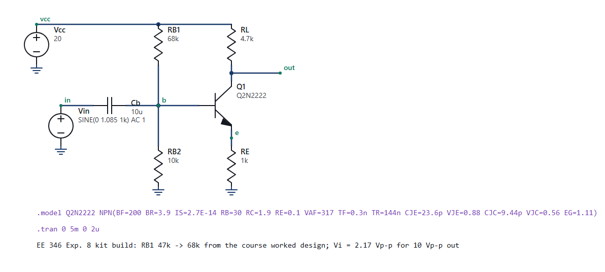
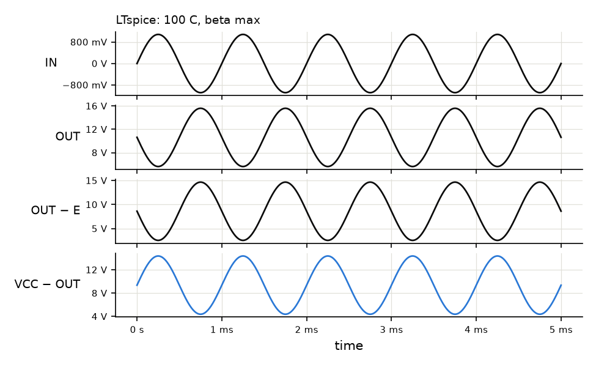
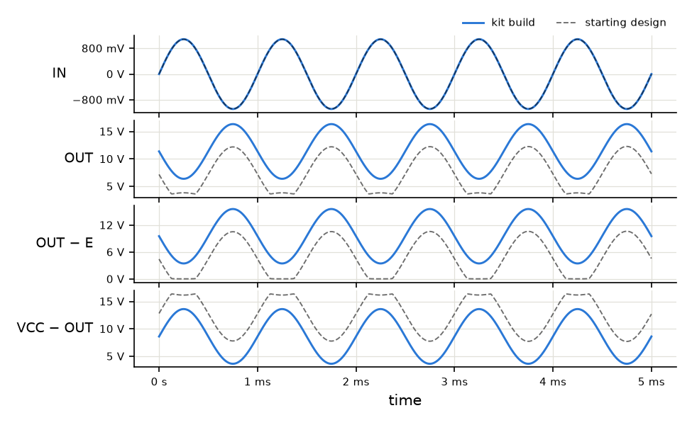
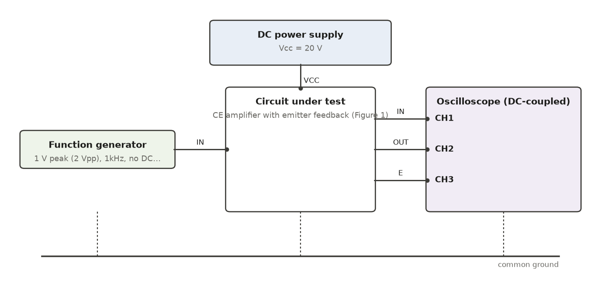

# spice-assistant

[](https://github.com/tankenbrandt/spice-assistant/actions/workflows/tests.yml)

## The problem

I tried using AI to design the circuits for my electronics labs. Across three
Claude models, every circuit simulated, but a circuit that simulates isn't
necessarily one that works:

- **It simulates, but it misses spec.** Sonnet 5's circuits all ran, yet only
  5–6 of 8 met spec. One amplifier had a gain of 107 instead of 50, and
  nothing flagged it.
- **It ignores tolerances.** Newer models (Sonnet 5.5, Opus 5.5) meet spec
  at nominal values 7–8 times in 8, but real resistors and transistors vary.
  Unprompted, Opus 5.5's amplifiers held spec in 75% of simulated real-part
  builds.
- **Told about tolerances, it gamed the test.** Once I said how it would be
  graded, Opus 5.5 scored 100%. All five of those designs used resistor
  values nobody sells (four 2275 Ω pieces in series), and one also used an
  ideal current source. Graded as the circuit could actually be built, the
  improvement disappeared.

## The goal

Describe a circuit, or hand over the lab handout, and get back:

- a design built from **the parts in my lab kit**, picked for the most margin
  against the spec, so I know which parts to grab when I get to lab;
- **simulations** at the extremes the handout cares about (temperature,
  transistor β), confirmed in a second simulator;
- the **schematic, pin layout, test-set block diagram and test plan** as a
  first draft of the pre-lab.

**In these classes pre-labs are not required or submitted. This is only to
use lab time more efficiently: walk in knowing what to build, which parts to
grab and what the scope should show.**

## The solution

1. **Writes the circuit.** From a plain-English description, Claude writes an
   ngspice netlist and repairs it until it simulates. With
   [`/prelab`](.claude/skills/prelab/SKILL.md), it works from the
   handout PDF instead.
2. **Checks the spec, not just that it runs.** A spec file says what
   "working" means (a gain, a swing, a truth table) and the extremes it must
   hold at. Misses go back to the AI with the measured numbers.
   *Answers: it simulates, but it misses spec.*
3. **Tests it with real parts.** Monte Carlo over resistor tolerances, β and
   supply gives the share of real builds that would still pass, and the
   range each bench reading should land in. *Answers: it ignores
   tolerances.*
4. **Designs from my kit.** It searches the parts I actually own, quantities
   and power ratings included, for the build with the most margin. Every
   value is one I have in the drawer. For the model benchmark,
   [`asbuilt.py`](asbuilt.py) grades the same way: it snaps every value to
   one that's sold, treats a string of resistors as the one part it makes,
   and refuses ideal current sources. *Answers: it gamed the test.*
5. **Gets a second opinion.** Everything is re-measured in LTspice, which
   shares no code with ngspice. LTspice also runs the `.asc` schematic I hand
   in, after checking that it matches the design.
6. **Drafts the pre-lab.** The Simulation, Design, Layout and Test Plan
   sections come out as a Word file: plots, schematic, pin assignments,
   test-set block diagram, and expected bench readings with their ranges.
   *Meets the goal.*

Only step 1 calls the Claude API. Hand it a netlist and everything else is
free and runs locally.

## Contents

- [Analog lab: designing a CE amplifier](#analog-lab-a-ce-amplifier-ee-346-experiment-8)
- [Quick start](#quick-start)

## Analog lab: a CE amplifier (EE 346, Experiment 8)

### What the lab asks

Choose R<sub>B1</sub>, R<sub>B2</sub>, R<sub>E</sub> and V<sub>CC</sub> for a
common-emitter amplifier (R<sub>L</sub> = 4.7 kΩ given) so that:

- the output swings **10 Vp-p with no distortion** (no clipping near
  saturation or cutoff),
- from **25 °C at β<sub>min</sub> to 100 °C at β<sub>max</sub>** (75 and
  325, the 2N2222 datasheet's range near this circuit's bias current),
- with a **gain of at least 2**, **V<sub>CC</sub> ≤ 20 V**, standard resistor
  values, and power ratings for each resistor.

Claude turned that into a netlist and a [spec file](labs/ee346_exp8/ce_amp.yaml)
of checks at each extreme, plus a third at the β I measured in the previous
lab. This was the session that became `/prelab`. The input is set from each
design's measured gain, so every design is tested at exactly 10 Vp-p out.

### The hand design, simulated

The starting point is the course's worked example: V<sub>CC</sub> = 20 V,
47k/10k divider, R<sub>E</sub> = 1k, which gives a gain of about 4.7. As a
netlist:

```spice
Vcc vcc 0 DC 20
Vin in 0 DC 0 AC 1 SIN(0 1 1k)
Cb  in b 10u
RB1 vcc b 47k
RB2 b 0 10k
RL  vcc out 4.7k
RE  e 0 1k
Q1  out b e Q2N2222      ; handout's 2N2222 parameters
```

**It saturates at both extremes.** The hand analysis checked the 5 V output
peak against V<sub>C</sub> = 6.8 V but left out the 2.8 V across
R<sub>E</sub>, so the bottom of the swing runs out of V<sub>CE</sub>:

| | 25 °C, β = 75 | 100 °C, β = 325 |
|---|---|---|
| Output (need 10 Vp-p) | 9.43 Vp-p ✗ | 7.95 Vp-p ✗ |
| Lowest V<sub>CE</sub> in the swing (need ≥ 1 V) | 0.06 V ✗ | 0.04 V ✗ |

### Designing from the kit

The tool tried every combination of resistors from my lab kit (the course's
3306L parts list, with its quantities: one 47k, two 10k, one 4.7k already
taken by R<sub>L</sub>) within 4× of the hand values. That's **96 buildable
combinations, and only 7 pass at every condition.** The pick moves one
resistor, **R<sub>B1</sub> 47k → 68k**, and nothing else.

The kit build as an LTspice schematic, `ce_amp.asc`, the file I hand in:

<p align="center">
  
</p>

*This sheet was laid out by hand (with Claude) to match the handout's
Figure 1. The tool's automatic `.asc` writer gets the connections right
but crosses wires on this circuit. Before using the file, the tool has
LTspice netlist it and checks the result against the design part by part,
so a stale 47k on the sheet would be caught.*

LTspice running that file, at the hot extreme (plotted from LTspice's own
output file; the pre-lab has one of these for each condition):

<p align="center">
  
</p>

The same comparison in ngspice, against the hand design (dashed). The hand
design's V<sub>CE</sub> (OUT − E) sits flat at 0 V for part of every cycle;
the kit build (solid) never comes close:

<p align="center">
  
</p>

| Kit build, R<sub>B1</sub> = 68k | 25 °C, β = 75 | 100 °C, β = 325 |
|---|---|---|
| Output | 9.98 Vp-p ✓ | 9.98 Vp-p ✓ |
| Gain | 4.56 ✓ | 4.60 ✓ |
| Lowest V<sub>CE</sub> | 4.19 V ✓ | 2.56 V ✓ |
| Q-point (V<sub>CE</sub>, I<sub>C</sub>) | 10.3 V, 1.70 mA | 8.64 V, 1.99 mA |
| Monte Carlo, ±10% resistors | 100% pass | 100% pass |

- **LTspice agrees:** running the `.asc` at every condition, it gives the
  same Q-points to three figures and every check passes.
- **With my own transistor:** I measured β = 116 at 1.7 mA in the previous
  lab (Exp. 7). At that β the hand design still clips (V<sub>CE</sub>
  bottoms at 0.05 V), while the kit build sits at V<sub>CE</sub> = 9.9 V,
  I<sub>C</sub> = 1.77 mA, gain 4.58: the numbers to expect at the bench.
- **Power ratings:** the worst resistor (R<sub>L</sub>) dissipates 18.7 mW,
  so even a 1/8 W part has over 6× margin; the kit's are 1/4 W.
- **Layout:** the 2N2222 is pin 1 emitter, 2 base, 3 collector in both the
  plastic and the metal-can package (checked against both datasheets), and
  the wiring list says which way round the 10 µF electrolytic goes: + lead
  on the base, which sits at 2.5 V.

### The test plan

The report also writes the test plan: equipment, the test-set block diagram
(the course's step 6), DC checkpoints, and a results table of expected
readings to fill in at the bench.

<p align="center">
  
</p>

```bash
python labreport.py --lab labs/ee346_exp8/lab.yaml --out runs/ee346_exp8   # about 30 s
```

At the bench, `--measured-template` writes a sheet listing every reading
with its expected value and predicted range
([Exp. 8's](labs/ee346_exp8/measured.yaml)). Fill it in and rerun with
`--measured`: the report fills *Measured* and *Pass?*, flags any reading
outside the predicted range (widened by the scope's accuracy,
`--meter-tol`), and checks the DC voltages too. I don't have bench readings
for this build, so these predictions haven't been checked at the bench.

## Quick start

```bash
pip install -e ".[labreport]"   # Python 3.10+, plus ngspice (setup in docs/how-it-works.md)
# In Claude Code, from the repo:  /prelab "Exp9 handout.pdf"
python labreport.py --lab labs/ee346_exp8/lab.yaml --out runs/ee346_exp8   # a whole pre-lab
python kit.py examples/ce_bjt_amp_recentred.cir --spec specs_lib/ce_bjt_amp.yaml
python main.py "an RC low-pass filter with a 1 kHz cutoff"   # needs ANTHROPIC_API_KEY
```

Install details, every module and how each claim above was verified:
**[docs/how-it-works.md](docs/how-it-works.md)**. 736 tests, no API calls,
CI on Linux and Windows.
