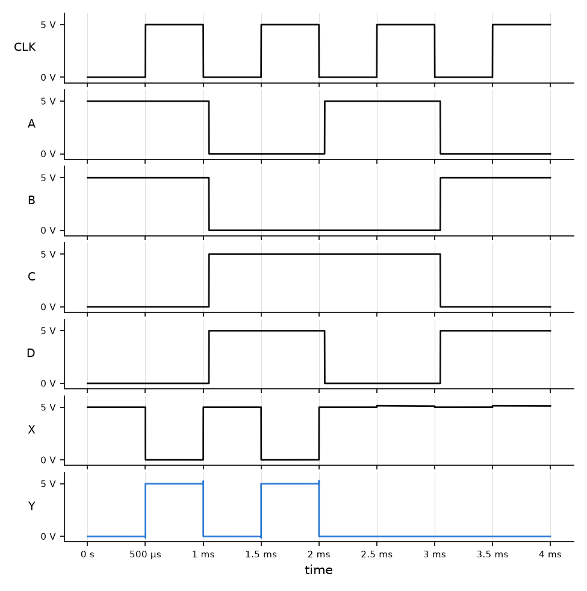
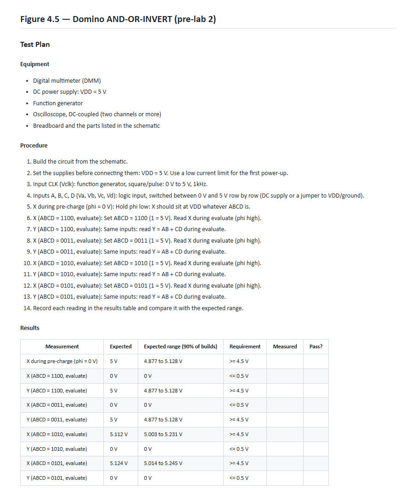
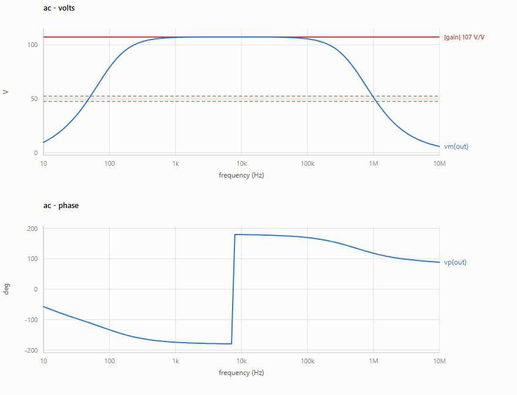
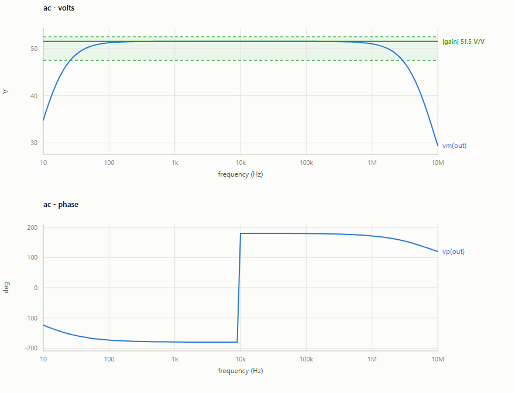

# spice-assistant

[](https://github.com/tankenbrandt/spice-assistant/actions/workflows/tests.yml)

**The problem.** A circuit that simulates isn't a circuit that works. In
September, Claude Sonnet 5 wrote eight circuits for me: all eight ran, and
only five or six met spec. Today's models (Sonnet 5.5, Opus 5.5) met spec 31
of 32 times. But even their *passing* amplifiers hold spec in only 63-91% of
simulated real builds, once part tolerances come in. "It simulated" isn't
proof, "it met spec once" isn't either, and both are as true of my own lab
circuits as of the AI's.

**What I wanted:** use AI to design and simulate circuits, check that they'll
work with real parts, fix whatever misses spec, confirm the answer in a
second simulator, and tell me which parts from my lab kit get closest to the
theory. Then hand me the pre-lab.

## What it does

1. **Writes the circuit.** You describe it in plain English and Claude writes
   an ngspice netlist, repairing it until it simulates.
2. **Checks it does what you asked.** A short spec file says what "working"
   means (gain = 50 ±5%, or a truth table). Misses go back to the AI with the
   measured numbers for a redesign.
3. **Tests it like a real build.** Monte Carlo over part tolerances, transistor
   spread and supply: what share of real builds would still pass.
4. **Gets a second opinion.** It re-measures everything in LTspice, which
   shares no code with ngspice.
5. **Picks parts from your kit.** It tries the nearest kit values and
   two-part series/parallel pairs, choosing them all together by simulation
   instead of rounding each one on its own.
6. **Writes the pre-lab.** It produces the Simulation, Design and Test Plan
   sections as a Word file, with plots, expected bench readings and a blank
   *Measured* column.

Only step 1 calls the AI. Hand it a netlist and everything else is free and
runs locally.

## In my lab: EE 347, static and dynamic CMOS gates

This is a real lab: five circuits built from CD4007 transistors and 4001B
gates. I turned each handout figure into a netlist and a truth-table spec
(with Claude Code's help). One command then produced the whole pre-lab in
about 25 seconds:

```bash
python labreport.py --lab labs/ee347_exp4/lab.yaml --out runs/ee347_exp4
```

- **All 37 truth-table rows** came out as expected, and LTspice agrees on all
  five circuits.
- **Pre-lab 2's timing diagram**, the domino gate over four clock periods,
  is laid out the way the handout draws it:

<p align="center">
  
</p>

- **It answers the handout's questions with numbers.** The NMOS pass-gate
  mux only pulls X to **5.19 V** from an 8 V supply (threshold plus body
  effect), and across part spread it lands at 5.0 to 5.4 V. The CMOS
  transmission-gate version reaches the full **8.0 V**.
- **It caught a timing mistake before the bench.** Changing the domino gate's
  inputs on the same clock edge that ends evaluation glitched X low. The
  inputs have to change once pre-charge has started.
- **It writes the test plan:** equipment, a bench step for every reading, and
  a results table with the expected value and the range 90% of real builds
  land in. I fill in the *Measured* column at the bench.

<p align="center">
  
</p>

### Where it fits in the course's ten-step method

Every lab is graded on a ten-step design-and-test method. The tool covers the
paperwork-heavy front half and leaves the engineering judgment to me:

| Step | What the tool does |
|---|---|
| 1. Specify | The spec file is the specification: inputs, outputs and limits, checked automatically from here on. |
| 2. Design (hand calculations) | **Not automated, on purpose.** The hand analysis is the point of the step. Put the hand-calculated values in the spec and the report sets them beside simulation. |
| 3. Simulate | Simulation in ngspice and LTspice, theory beside simulation, netlists and plots. `.asc` files via `ascgen.py` for discrete circuits; not yet for IC subcircuits like the 4001B. |
| 4. Layout | Not yet. |
| 5. Test plan | Generated: equipment, procedure, expected readings. |
| 6. Test-set block diagram | Not yet. |
| 7–9. Build, test, parasitics | At the bench. |
| 10. Discuss (double weight) | The expected-range column makes the comparison quantitative: a reading outside it means something is wrong. |

## Picking parts from the kit

When theory asks for a value the drawer doesn't have, rounding each part on
its own can push the circuit out of spec. Parts interact, so the tool picks
them together:

| Circuit | Ideal value | Rounding each part | Joint pick |
|---|---|---|---|
| Active low-pass, f<sub>c</sub> = 1 kHz | C<sub>f</sub> = 1.5915 nF | 1.5 nF → 1047 Hz | 1.5 nF ∥ 100 pF → 982.6 Hz |
| CE amplifier, gain 50 | R<sub>C</sub> 7.5k, R<sub>E2</sub> 910 | gain 48.1 | 6.8k and 820, both −9%, ratio kept → gain 50.04 |

Monte Carlo then says how much the kit's tolerance matters. On the filter, a
±10% capacitor alone puts 18% of builds outside a ±5% corner-frequency
requirement. That's worth knowing before you start debugging a "wrong" bench
reading. The kit itself is a file (`kit.yaml`), E12/E6 by default.

## When the AI's circuit is wrong: gain 107 instead of 50

*Claude Sonnet 5, September 2026. Current models get much closer; see
[More results](#more-results).*

Asked for a common-emitter amplifier with a gain of −50, the AI wrote a
textbook-looking circuit that ran perfectly and measured a gain of **107**:

<p align="center">
  
</p>

Its 100 µF bypass capacitor shorts the *whole* emitter resistor, so the gain
is set by the transistor's own r<sub>e</sub> rather than by the design. The
bias point shows the warning sign: only 0.1 V across the emitter. Across real
builds that gain swings from 42 to 163, and **1%** of builds meet spec.
Given the measured gain, the AI made the textbook fix: it split the emitter
resistor and left 56 Ω unbypassed.

<p align="center">
  
</p>

Gain **51.5**, and LTspice reads 51.5265 against ngspice's 51.5266. One build
in three still missed: 51.5 sits near the top of the window. Moving one
resistor (56 → 59 Ω) takes yield from 69% to **92%**.

## More results

- **Benchmark, 8 circuits × 4 runs per model:**

  | Model | Simulate | Meet spec | CE amp real-build yield, passing designs |
  |---|---|---|---|
  | Sonnet 5 (Sept 2026) | 8/8 | 5–6 | none passed (1% yield; 69% after the tool's repair) |
  | Sonnet 5.5 (Nov 2026) | 8/8 | 7–8 | 63–85% |
  | Opus 5.5 (Nov 2026) | 8/8 | 7–8 | 85–91% |

  Newer models fixed nominal correctness; tolerance is now where designs
  fail. All four runs per model cost $0.33–0.59.
- **EE 346 diode lab (AI-designed):** 9 of 10 designs were correct, and the
  spec caught the one with a reversed clamper diode. Writing the specs also
  showed that the handout's V<sub>p</sub>/π rectifier estimate runs about 10%
  high. And it caught the AI's repair loop "passing" by quietly changing the
  handout's given source values; repairs now treat the assignment as fixed.

## Quick start

```bash
pip install -e ".[labreport]"   # Python 3.10+, plus ngspice (setup in docs/how-it-works.md)
python labreport.py --lab labs/ee347_exp4/lab.yaml --out runs/ee347_exp4   # a whole pre-lab
python kit.py examples/ce_bjt_amp_recentred.cir --spec specs_lib/ce_bjt_amp.yaml
python main.py "an RC low-pass filter with a 1 kHz cutoff"   # needs ANTHROPIC_API_KEY
```

Install details, every module and how each claim above was verified:
**[docs/how-it-works.md](docs/how-it-works.md)**. 651 tests, no API calls, CI
on Linux and Windows.
