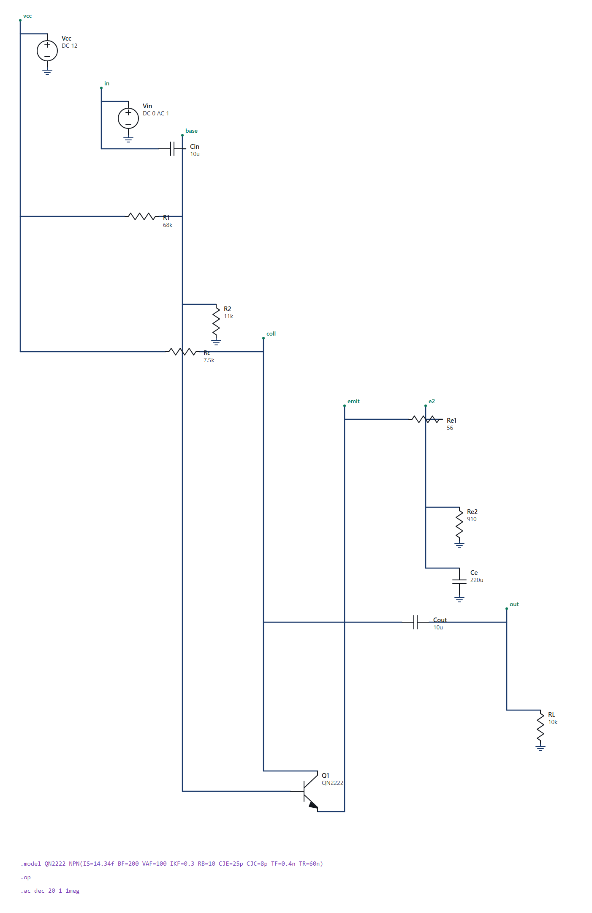
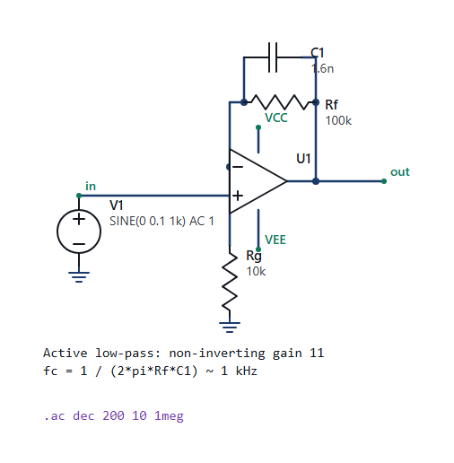
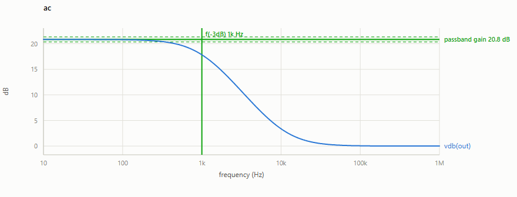

# spice-assistant

[](https://github.com/tankenbrandt/spice-assistant/actions/workflows/tests.yml)

Describe an analog circuit in plain English and get back a simulation you can
trust. That means one that has been checked against what you actually asked
for, with real part tolerances, and in two different simulators.

## What it does

- **Writes the circuit.** You describe it ("a common-emitter amplifier with a
  gain of -50") and Claude writes an ngspice netlist.
- **Makes sure it runs.** If ngspice rejects the netlist, the error goes back
  to the model to fix.
- **Checks it does what you asked.** A short spec file says what "working"
  means (gain = 50 ±5%, output = 5 V ±3%). The tool measures the circuit
  against it, and if it misses, sends the measured numbers back for a
  redesign.
- **Shows the bias point.** Every node voltage and every current, the same
  DC analysis you do by hand in class.
- **Tests it like a real build.** It simulates the circuit a few hundred
  times with resistors off by their real tolerance, a transistor with a
  different beta, the supply a little low and the room hot or cold. Then it
  tells you what share of real builds would still meet spec.
- **Gets a second opinion.** The same measurement is re-run in LTspice, a
  completely separate simulator, to make sure the answer isn't an ngspice
  quirk.
- **Draws it.** You get a schematic image and an LTspice `.asc` file you can
  open, probe and edit.
- **Puts it all in one report** with a single command.
- **Builds it from my lab kit and writes the pre-lab.** Give it the handout's
  circuit with its theory values. It picks the closest parts the kit actually
  has, including two-part series/parallel combinations, by simulating each
  candidate build. Then it writes the Simulation, Design and Test Plan
  sections of a lab report as a Word file (upload it to Google Drive to get a
  Google Doc). See [From handout to pre-lab](#from-handout-to-pre-lab-kitpy-labreportpy).

Only the first step (writing the circuit) uses the AI and costs money. If you
already have a netlist, everything else is free and runs on your machine.
Setup is in [Install](#install).

## Worked example: the common-emitter amplifier

This is the circuit from every electronics lab: one NPN transistor, a bias
divider, coupling capacitors and a target gain. The assignment is a
common-emitter amplifier with a 2N2222-style transistor, a 12 V supply and a
voltage gain of about -50.

### 1. Describe it

```powershell
python main.py "a common-emitter BJT amplifier using an NPN transistor (2N2222-style model) with a small-signal voltage gain of approximately -50, powered from a 12V supply ..."
```

The model wrote [`baseline/ce_bjt_amp.cir`](baseline/ce_bjt_amp.cir). It looks
like the textbook version: a 220k/16k bias divider, a 5k collector resistor,
and a 100 Ω emitter resistor with a 100 µF capacitor across it.

### 2. Does it run?

Yes. ngspice runs it with no errors and prints a gain. This is where most
checking stops, including mine in lab most of the time. The circuit ran, so it
must be right.

### 3. Does it do what I asked?

No. The spec says gain = 50 ±5%. The measured gain is **107**, more than
double.

<p align="center">
  
</p>

The reason is the 100 µF capacitor. At signal frequencies it shorts out the
whole emitter resistor. The gain of a common-emitter stage is roughly
R<sub>C</sub> divided by whatever sits in the emitter. With the resistor
bypassed, all that is left is the transistor's own r<sub>e</sub> of about
26 Ω. So the gain is set by the transistor rather than by anything you
chose, and it came out wherever it came out.

### 4. Look at the bias point

```powershell
python oppoint.py baseline/ce_bjt_amp.cir
```

| Node | Voltage |   | Device | Current |
|---|---|---|---|---|
| base | 0.744 V | | Q1 collector | 0.99 mA |
| emitter | 0.0996 V | | Q1 base | 4.7 µA |
| collector | 7.04 V | | | |

These are the numbers you would compute by hand in a DC analysis. The
transistor is in the active region (V<sub>CE</sub> ≈ 6.9 V), so the bias
itself works. But **only 0.1 V across the emitter resistor** is a red flag.
The usual rule of thumb is around 1 V. With so little there, the collector
current depends heavily on the transistor's beta and on temperature, which
matters in step 6.

### 5. Fix it

```powershell
python design.py --deck baseline/ce_bjt_amp.cir --spec specs_lib/ce_bjt_amp.yaml -o fixed.cir
```

The model gets the measured gain back ("107, target 50") and redesigns. The
fix it chose ([`repaired/ce_bjt_amp.cir`](repaired/ce_bjt_amp.cir)) is the one
the textbook teaches. It splits the emitter resistor into 56 Ω left
unbypassed plus 910 Ω bypassed, so the gain is set by R<sub>C</sub> / (r<sub>e</sub> + 56 Ω).
It also re-biases the divider (68k/11k) so the emitter sits near 1 V.
(That deck came from the benchmark's repair run. The model's answer varies
from run to run, but the check it has to pass doesn't.)

<p align="center">
  
</p>

Measured gain: **51.5**. Pass.

### 6. Will it work when I actually build it?

A simulation uses perfect parts. A real board doesn't. The robustness check
builds the circuit 500 times in simulation. Each build uses resistors
anywhere within their 5% tolerance, a transistor beta anywhere within ±50% of
nominal, a supply within 5%, and a temperature between -40 and 85 °C.

| Design | Nominal gain | Gain across builds | Builds in spec |
|---|---|---|---|
| First try (step 1) | 107 | 42 to 163 | **1%** |
| Fixed (step 5) | 51.5 | 47 to 56 | **69%** |
| Fixed, Re1 = 59 Ω | 49.7 | 45.5 to 54 | **92%** |

The first design isn't just wrong, it's unpredictable. Its gain swings by a
factor of almost four depending on which transistor you get, which is the
0.1 V emitter problem from step 4.

The fixed design is steady, but one build in three still misses. The tool can
also say *why*: switching to 1% resistors moves the yield by about one
point. Spread isn't the problem. The problem is that 51.5 sits near the top
of the 47.5 to 52.5 window. Trying the standard values either side of 56 Ω
turns up 59 Ω, which puts the gain at 49.7 and **92%** of builds in spec. That
is one resistor, not an order for precision parts.
([`examples/ce_bjt_amp_recentred.cir`](examples/ce_bjt_amp_recentred.cir))

### 7. Second opinion

The same measurement run in LTspice, which shares no code with ngspice, gives
51.5265 against ngspice's 51.5266.

### 8. Open it in LTspice

The report includes an `.asc` file, so the circuit opens in LTspice for
probing like any schematic you drew yourself.

<p align="center">
  
</p>

### All of it in one command

```powershell
python report.py repaired/ce_bjt_amp.cir --spec specs_lib/ce_bjt_amp.yaml --out runs/amp
```

```
  [1/6] netlist..................... `repaired/ce_bjt_amp.cir`
  [2/6] schematic................... 12 devices -> ce_bjt_amp.svg
  [3/6] operating point............. 7 nodes, 12 branches
  [4/6] spec check.................. PASS
  [5/6] monte carlo................. yield 66% over 200 samples
  [6/6] ltspice cross-check......... 4/4 agree within 1.0%
```

This writes `runs/amp/report.md` with the schematic, bias point, spec
verdict, build-to-build spread and the LTspice comparison on one page. (The
yield reads 66% here and 69% above because this run uses 200 samples rather
than 500.)

### Why this is useful to me

As an EE student, I usually check a circuit like this in three steps: hand
calculations, one simulation, then the bench. This tool fills the gaps between
them.

- **It catches "it simulated, so it's right."** The amplifier above ran
  perfectly and was wrong by a factor of two. I would have found that at the
  bench, after building it.
- **It explains the failure in terms I already know**, like the bias point, the
  emitter voltage and r<sub>e</sub>, instead of just saying "fail".
- **It answers a question hand analysis can't**: will this still work with the
  parts in the lab kit? It also says whether better parts would help (here
  they wouldn't) or whether one value should change (here it should).
- **It gives me an LTspice file**, which is what my classes use, so I can keep
  working on the design myself.
- **Checking my own circuits is free.** The AI is only needed to write a
  circuit from a description. Give it a netlist I wrote and everything else
  runs locally.

---

# Under the hood

Everything below is the detail: how well the AI does on its own, how each
layer works, and what was verified.

## How good is the AI at this, really?

The worked example isn't a one-off. On an 8-circuit benchmark, "does it run?",
"does it meet spec?" and "does it keep meeting spec across real parts?" get
three very different answers: **100% simulate cleanly, 62-75% meet spec**,
and the worst offender had a **1% Monte Carlo yield** before repair. Judged
by "it ran", the AI looks 25 to 38 points better than it really is.

| Layer | Question | Cost |
|-------|----------|------|
| `main.py` | does the deck simulate at all? | one API call per repair |
| `speccheck.py` + `specs.py` | does it meet its electrical spec? | free (ngspice only) |
| `robustness.py` | how often does it meet it, across tolerance, supply and temperature? | free (ngspice only) |

Those are four independent runs, not one. Generation is sampling, so a single
run is an anecdote. Across 4 runs (`python repeat_summary.py`) every circuit
simulated cleanly **every time**, while the spec pass rate moved between 5 and
6 of 8. `buck_converter` and `ce_bjt_amp` fail their spec in *all four*, and
the rectifiers are borderline and each fail once. The reproducible part is the
gap, not the second decimal place.

Every measurement is then cross-checked against a **second, independently
written simulator**. The same spec is re-measured in LTspice, headlessly, and
**9 of 10 circuits agree within 1%**, most to six significant figures. See
[Two simulators, one spec](#two-simulators-one-spec-crosscheckpy-ltspicepy).

<p align="center">
  
</p>

## Circuits from a real lab handout (`--lab`)

The benchmark's weak point is that I picked its circuits. The lab round
takes them from a course handout instead: Cal Poly EE 346, Experiment 4
(diode circuits). It covers the clipper, clamper, half-wave and bridge
rectifier with the handout's own part values and 1N4001 diodes, plus one
inverting active low-pass filter. Each has a spec in `specs_lib/` and a
hand-built deck in `reference/` that meets it:

| Circuit | What the spec checks | Reference deck |
|---|---|---|
| `lab_clipper` | clips at ±(1.5 V + V<sub>d</sub>), 1.7-2.4 V | ±1.99 V |
| `lab_clamper` | low level near -V<sub>d</sub>, high near 9.5 V, **average near 4.5 V** | -0.67 / 9.67 / 4.47 V |
| `lab_halfwave` | V<sub>dc</sub> = 2.87 V ±5%, never negative | 2.88 V |
| `lab_bridge` | V<sub>dc</sub> = 5.12 V ±5% across the floating load | 5.19 V |
| `inv_active_lowpass` | 20 dB ±0.5, f<sub>c</sub> = 1 kHz ±5%, inverting | 20.0 dB, 988 Hz |

Writing the specs caught two things worth knowing for the lab itself.

- **The handout's V<sub>p</sub>/π check is about 10% high.** A real diode
  takes V<sub>d</sub> off the peak and also conducts for less of the cycle.
  The exact average is (V<sub>p</sub> cos θ₀ − V<sub>d</sub>(π/2 − θ₀))/π with
  θ₀ = asin(V<sub>d</sub>/V<sub>p</sub>): 2.87 V, not 3.18 V. The simulation
  lands at 2.88 V.
- **Peaks alone can't tell a working clamper from a broken one.** With the
  handout's R = 2.2k (RC = 0.22 ms against a 1 ms period) the output is a
  train of decaying spikes that still hit -0.7 V and +9.9 V. The average
  level is what separates them: 4.47 V clamped versus 1.97 V not.

Every spec is also tested against a broken version of its deck: a reversed
diode, missing batteries, a capacitor 10x off, the op-amp wired
non-inverting, and a changed input signal. All 10 are rejected. In LTspice,
every DC level and gain agrees within 0.1%. The strict cross-check counts 11
of 15 circuits within 1%. The new misses are "never negative" readings, where
both simulators report roughly zero (a few µV against about 1 mV), and the
clamper's edge spike at 1.008%.

### What the AI did with them

Two runs of `benchmark.py --lab --spec-repair` gave 10 generated designs
(`logs/run_log_lab_v1.json`, `logs/run_log_lab.json`, $0.12 in all). All 10
simulated first time. **9 were correct circuits. One was a real mistake:**
the clamper's diode was wired backwards, so it clamped negative (-9.6 V to
+0.5 V). That orientation is the whole point of that part of the lab, and
the spec caught it.

The first run also caught more of my mistakes than the AI's:

- **Two specs failed correct circuits.** A bridge and a clipper wired
  exactly like the reference missed their bands only because the model
  picked a 1N4001 with a lower forward drop (N = 1.45-1.65 against 1.98).
  Real parts vary like that, so the bands now cover it (bridge ±8%, clipper
  1.7-2.4 V) and still reject every broken version above.
- **A min() read a switching spike as the clamp level.** The clamper's
  "low level" is now where the trace sits (the 5th percentile of time). A
  circuit identical to the reference no longer fails because its input
  edges were 1 ns instead of 1 µs.
- **The repair loop changed the assignment to pass.** Handed a failing
  number, it cut the bridge's source from 10 V to 9.5 V, raised the
  clipper's batteries from 1.5 V to 1.74 V, and slowed the clamper's input
  edges. Two defences followed. Every lab spec now measures its input
  signal, so changing the stimulus fails. And a lab repair now sees the
  original description as fixed requirements. With the same broken clipper
  repaired both ways (`logs/repair_requirements_ab.json`), the version
  without the description raised the batteries to 1.6 V. The version with it
  kept 1.5 V and replaced the unrealistic diode model, which was the actual
  fault. `design.py` passes the description the same way. Rounds 1-2 keep
  the repair prompt they were published with.

```powershell
python benchmark.py --lab          # generate all five from their descriptions (API)
python speccheck.py reference/lab_clamper.cir --spec specs_lib/lab_clamper.yaml
```

## The generate-and-repair CLI

A tiny CLI that turns a plain-English circuit description into a working
[ngspice](https://ngspice.sourceforge.io/) netlist. It asks Claude for a
netlist, runs it through `ngspice -b`, and if the simulation fails it feeds the
error back to the model for a correction — retrying up to 4 total attempts. At
the end it prints the final netlist **and** the full ngspice output so you can
see exactly what happened.

ngspice is called directly as a subprocess in batch mode. There is intentionally
no PySpice / InSpice / other binding — raw text in, raw text out.

## Requirements

- Python 3.10+
- ngspice on your `PATH` (or reachable via `NGSPICE_PATH`, or bundled under
  `tools/Spice64/bin`)
- An Anthropic API key **only for `spice-assistant` and the benchmark**. The
  spec, robustness, plotting and schematic tools are ngspice-only and cost
  nothing to run.

## Install

```powershell
# from the project root
py -m venv .venv
.\.venv\Scripts\Activate.ps1
pip install -e .
```

That installs the CLIs on your `PATH`:

| Command | Module | Does |
|---------|--------|------|
| `spice-report` | `report.py` | one circuit, every layer, one report |
| `spice-assistant` | `main.py` | description -> netlist -> simulate -> self-heal |
| `spice-speccheck` | `speccheck.py` | measure a deck and judge it against a spec |
| `spice-robustness` | `robustness.py` | Monte Carlo, sensitivity, worst case, PVT |
| `spice-plot` | `plot.py` | waveforms with the acceptance band on them |
| `spice-netlist` | `netlist.py` | `.asc` schematic -> ngspice deck |
| `ascview` | `ascview.py` | render a `.asc` without LTspice |
| `spice-symlib` | `symlib.py` | inspect LTspice's own `.asy` symbol library |
| `spice-op` | `oppoint.py` | every node voltage and branch current in a deck |

Every example below also works as `python <module>.py ...` straight from a
clone, with no install. Only `spice-assistant` needs an API key; everything
else is ngspice only.

### ngspice

**Windows** (this repo was set up on Windows): the official ngspice binary is
bundled under `tools/Spice64/bin` (downloaded from SourceForge). `main.py` finds
it automatically, so nothing else is needed. To make `ngspice` available in your
own shells, add that folder to `PATH`:

```powershell
$bin = "$PWD\tools\Spice64\bin"
setx PATH "$env:PATH;$bin"   # new shells only; restart the terminal after
```

**macOS / Linux**: install via your package manager and it will be on `PATH`:

```bash
brew install ngspice      # macOS
sudo apt install ngspice  # Debian/Ubuntu
```

`main.py` resolves the executable in this order: `NGSPICE_PATH` env var →
`ngspice_con`/`ngspice` on `PATH` → the bundled `tools/Spice64/bin` copy.

### API key

```powershell
$env:ANTHROPIC_API_KEY = "sk-ant-..."   # current shell
# or persistently:
setx ANTHROPIC_API_KEY "sk-ant-..."     # new shells only
```

Or drop a `.env` file next to `main.py` — every entry point reads it, and a
real environment variable always wins over the file:

```
ANTHROPIC_API_KEY=sk-ant-...
```

## Usage

```powershell
python main.py "a first-order RC low-pass filter with a 1kHz cutoff frequency and a 5V DC source"
```

Progress lines (attempt N, success/failure) are written to stderr; the final
netlist and full ngspice output go to stdout. The process exits `0` on a
successful simulation, `1` if all attempts failed.

## How it works

`main.py` exposes three functions:

- `generate_netlist(description)` — one Anthropic call (`claude-sonnet-5`) that
  returns netlist-only text; stray ``` fences are stripped defensively.
- `run_ngspice(netlist_text)` — writes a temp `.cir`, runs `ngspice -b`, and
  returns `(success, combined_output)`. Because ngspice often exits `0` even on a
  bad deck, success also requires that the output contains no error signatures.
- `fix_netlist(netlist_text, error_output)` — sends the failing netlist plus the
  ngspice output back to the model and returns a corrected netlist.

## Designing to a spec (`design.py`)

`main.py` stops at "it simulates". The benchmark is the case against stopping
there: every deck ran, and `ce_bjt_amp` and `buck_converter` missed their spec
in all four runs. `design.py` keeps going until the spec passes, for any spec
in `specs_lib/`:

```powershell
python design.py "a common-emitter amplifier, gain -50" `
    --spec specs_lib/ce_bjt_amp.yaml -o amp.cir
python design.py --deck my_buck.cir --spec specs_lib/buck_converter.yaml -o fixed.cir
```

It generates, repairs simulation errors, measures the spec, and while it fails
sends the model the measured values back -- up to `--rounds` times (default 3).
It differs from the benchmark's repair loop in two ways:

- **The spec goes in before the design does.** The model sees the acceptance
  limits and which vectors the harness will read, so it designs to a number
  rather than to a paragraph.
- **A repair sees the bias point.** For a small-signal or DC spec, the prompt
  carries the `oppoint.py` table as well as the measurement: "gain is 107"
  says the design is wrong, `emit = 99.6 mV` with a 1 mA emitter current says
  which resistor to change. For a transient-only spec (converters,
  rectifiers) it is left out -- the DC point of a buck converter is its switch
  open and 0 V out, which is true and misleading.

`report.py --describe ... --spec ...` uses the same loop, so a generated
report is of a deck that meets its spec, or says that it does not.

Against the two circuits that always failed, two trials each
(`logs/design_trials.json`, 7 API calls, about $0.12):

| Circuit | Benchmark, first try | `design.py`, first try | After repair |
|---|---|---|---|
| `ce_bjt_amp` | \|gain\| 107, failed 4 of 4 | 48.2 pass, 43.7 fail | 48.4, 1 round |
| `buck_converter` | 4.52 V, failed 4 of 4 | 4.51 V, 4.52 V: both fail | 5.09 V, 5.07 V, 1 round each |

All four end inside their spec. Stating the spec up front fixed the amplifier's
*design* -- from twice the gain to within 13% -- and did nothing for the buck,
which still forgets the freewheeling diode's drop on every first try; one
round of measured feedback fixes that. Two trials is a direction, not a rate.

## The whole chain, one report (`report.py`)

Every tool below answers one question and prints to a terminal. That is the
right shape for a test and the wrong shape for handing someone a design.
`report.py` runs the whole chain against a single circuit and writes a report
you can read, attach to a lab notebook, or bring to a design review:

```powershell
# from a deck you already have -- ngspice and LTspice only, no API key
python report.py repaired/ce_bjt_amp.cir --spec specs_lib/ce_bjt_amp.yaml --out runs/amp

# or start from a description (this is the one layer that costs anything)
python report.py --describe "a common-emitter amplifier with gain -50" `
    --spec specs_lib/ce_bjt_amp.yaml --out runs/amp
```

```
spice-report -> runsaseline
  [1/6] netlist..................... `baseline/ce_bjt_amp.cir`
  [2/6] schematic................... 12 devices -> ce_bjt_amp.svg
  [3/6] operating point............. 7 nodes, 12 branches
  [4/6] spec check.................. FAIL
  [5/6] monte carlo................. yield 1% over 500 samples
  [6/6] ltspice cross-check......... 4/4 agree within 1.0%
```

`runs/amp/report.md` carries all of it: the schematic as a rendered SVG and as
an `.asc` that opens in LTspice, every node voltage and branch current, the
spec verdict with each measurement against its limits, the Monte Carlo
distribution and yield, and the second simulator's answer to the same spec.

A layer that cannot run is recorded rather than fatal -- LTspice missing, a
deck too exotic to draw -- because the circuit you most want a report on is
the one that is going wrong. Without `--spec` it still runs, and stops after
the operating point.

`--out` must not be the project root: `report.md` and the committed
`REPORT.md` are the same file on a case-insensitive filesystem.

### Where is this circuit sitting? (`oppoint.py`)

A spec is deliberately narrow -- it names the handful of vectors it cares
about, and `speccheck` dumps exactly those. But the first question in front of
a circuit is usually not "does it pass", it is "where is it sitting", and a
bias point that looks wrong explains a gain that measures wrong.

```powershell
python oppoint.py repaired/ce_bjt_amp.cir
```

```
7 nodes, 12 branches

  node voltages
    base       1.62V
    coll       4.44V
    emit        979mV
    vcc          12V

  device currents
    q1    Ic 1.01mA, Ib 4.92uA, Ie -1.01mA
    rc    I 1.01mA
    r1    I 153uA
```

No spec had to anticipate any of it: `op` + `print all` gives every node, and
one `show` gives every device's currents. Two things in that output are traps
worth knowing about, and both are tested:

- **`ic` is not always a current.** It is collector current on a BJT and the
  *initial condition* on a capacitor or inductor, where ngspice answers with a
  perfectly plausible `0` instead of refusing. Each device type is read only
  for the currents it actually has. A MOSFET's `ib` is bulk leakage, not a
  base current, for the same reason.
- **A deck with no nodes still prints eleven of them.** With nothing in the
  operating-point plot, `print all` quietly falls back to ngspice's
  *constants* plot -- `pi`, `boltz`, `echarge`, `kelvin`. Those are filtered on
  value as well as name, so a real node that happens to be called `c` survives
  and one sitting at 3e8 volts does not.

## From handout to pre-lab (`kit.py`, `labreport.py`)

A handout's theory says Cf = 1.5915 nF; the drawer has 1.5 nF and 2.2 nF.
`kit.py` picks real parts from `kit.yaml`. That file is an assumed kit (E12
resistors ±5%, E6 capacitors ±10%) until it is replaced with a real course
parts list. For each R, C and L it tries the nearest kit value on each side
and the best two-part series/parallel pair. It simulates the candidate
builds, jointly rather than one part at a time, and keeps the build whose
*measurements* land closest to the spec. Parts the kit already has are left as
given.

```bash
python kit.py examples/ce_bjt_amp_recentred.cir --spec specs_lib/ce_bjt_amp.yaml
```

Joint search matters because parts interact. In the CE amplifier, Rc (7.5k)
and Re2 (910) are not E12 values. Rounding each part on its own gives a gain
of 48.1. The search moves both down about 9%, which keeps their ratio, and
the gain lands at 50.04. In the active low-pass, rounding Cf gives fc =
1047 Hz. 1.5 nF ∥ 100 pF gives 982.6 Hz.

`labreport.py` turns the same inputs into the three pre-lab sections:

```bash
python labreport.py reference/inv_active_lowpass.cir --spec specs_lib/inv_active_lowpass.yaml \
    --title "Lab 5: Active filters" --out runs/lab5
```

- **Simulation:** the ideal circuit, theory beside simulation, a plot (ideal
  dashed, kit build solid) and the netlist.
- **Design:** the parts chosen and how far each is from ideal, what rounding
  alone would have given, predicted performance, and a Monte Carlo run over
  the kit's tolerances. On the low-pass this shows that a ±10% capacitor
  alone puts 18% of builds outside a ±5% corner-frequency requirement.
- **Test plan:** equipment, a DMM check for every part with its acceptable
  reading, supply settings, DC checkpoints, one bench step per measurement
  ("raise the frequency until the output falls to 0.707×…"), and a results
  table with the expected value, the range 90% of real builds land in, and
  an empty *Measured* column.

It writes `report.docx`, `report.md`, the kit-build deck and the figures. It
needs `python-docx` and `matplotlib` (both in `requirements-dev.txt`). Like
everything except generation, it makes no API calls.

## Specs for your own circuits (`specs_lib/`, `specs.py`)

The benchmark's spec checks are one hand-written Python function per circuit,
which is fine for a fixed test set and useless for your own amplifier. A
**declarative spec** describes a measurement instead of implementing it --
run an analysis, pull a quantity out of the resulting vectors, compare it to
a limit:

```yaml
circuit: rc_lowpass
analyses:
  ac: {command: ac dec 200 10 1meg, vectors: [vdb(out)]}
measurements:
  - name: f3db
    label: f(-3dB)
    units: Hz
    extract: {kind: crossing, of: vdb(out), level: first - 3, direction: falling}
    target: 1000
    tol: 5%
```

```powershell
python speccheck.py my_filter.cir --spec my_filter.yaml
python robustness.py my_filter.cir --spec my_filter.yaml --mc 500 --sens --worst
```

**One spec file drives both layers.** The measurements that produce the
nominal verdict are the same ones Monte Carlo, sensitivity and worst-case
perturb, so a circuit is described once and signed off end to end.

Extractors: `max`, `min`, `mean`, `peak_to_peak`, `crossing`, `value_at`,
`at_peak`. A `window: last 20%` restricts a transient to steady state, and
levels may reference the curve itself (`first - 3`, `max / sqrt(2)`).
Measurements can be `expr`-derived from earlier ones (`q: f0 / (f_hi - f_lo)`),
and intermediates that exist only to be referenced are marked
`informational: true` so they are measured and reported without deciding the
verdict. Expressions are evaluated through an AST whitelist, so a spec file
is data, not code.

The ten specs in `specs_lib/` cover the benchmark's circuits, and the test
suite asserts that each one reaches the same verdict *and the same measured
number* as the hand-written checker it replaces.

## Plotting what the spec measured (`plot.py`)

`speccheck` prints a number; `plot.py` draws the curve it came from, with the
acceptance band on it.

```powershell
python plot.py my_filter.cir --spec my_filter.yaml --open
python plot.py deck.cir --analysis "tran 10u 5m" --vectors "v(in)" "v(out)"
```



The HTML page carries a crosshair readout (every series at the pointer's
frequency), a legend, and a table of the specs, so the numbers stay reachable
without hovering. Vectors are grouped into panels **by unit**, so a Bode plot
is a magnitude panel stacked on a phase panel rather than one chart with two
y-scales: with two scales on one set of axes, wherever the curves cross is an
artefact of where the scales were pinned, not a fact about the circuit.

## Schematic to netlist (`netlist.py`)

Closes the loop: extract the connectivity from an `.asc` and emit a deck, so a
schematic drawn in LTspice can be simulated and verified here.

```powershell
python netlist.py schematic.asc -o deck.cir
python netlist.py schematic.asc --pinorder "OP07=in+,in-,v+,v-,out"
python netlist.py schematic.asc --strict     # fail rather than emit a TODO
```

Nets come from the drawing. Wire endpoints and symbol pins are merged with a
union-find, including T-junctions where a wire lands part-way along another,
and a net takes its name from any `FLAG` on it (`0` for ground); the rest
become `N001`, `N002`, ...

What it will not do is invent a pin order. Primitives have a fixed, verified
order. A library part's subcircuit pin order is a property of the library, not
the drawing, so by default it is emitted as a commented `X` line listing the
nets its pins landed on, and `--pinorder` is how you state the real one.

That T-junction rule earns its keep. The first version of the example
schematic looked right and passed `ascview --check` -- every pin sat on a
wire -- but the feedback wire ran straight *through* the non-inverting input
pin on its way down to `Rg`, shorting the two op-amp inputs. `--check` cannot
see that; extracting the netlist named both inputs the same net and made it
obvious.

## The op-amp example (`examples/`)

`examples/` holds an active low-pass filter in all four forms: schematic, netlist, spec, and
the plot above. The schematic is self-contained -- supplies and the op-amp
macromodel included -- so the deck extracted from it measures **identically**
to the hand-written one, which the test suite asserts.

```powershell
python ascview.py examples/active_lowpass.asc --open
python netlist.py examples/active_lowpass.asc --pinorder "OP07=in+,in-,v+,v-,out"
python speccheck.py examples/active_lowpass.cir --spec examples/active_lowpass.yaml
python robustness.py examples/active_lowpass.cir --spec examples/active_lowpass.yaml --mc 500 --sens
python plot.py examples/active_lowpass.cir --spec examples/active_lowpass.yaml --open
```

The sensitivity output doubles as a check that the layer measures physics
rather than noise. For `fc = 1 / (2*pi*Rf*C1)` it reports **-1.01 %/% for C1
and -1.02 %/% for Rf**, and for the gain it reports equal and opposite
sensitivities to `Rf` and `Rg`. Those are the textbook answers.

## Viewing LTspice schematics (`ascview.py`)

Opens LTspice `.asc` schematic files **without LTspice** and renders them to a
standalone SVG, an HTML page, or a PNG — for screenshotting into lab reports.

```powershell
python ascview.py "Sallen-Key Filter Sim.asc" --open     # render + open in browser
python ascview.py sch.asc --png                          # also write a PNG
python ascview.py sch.asc --format svg --theme dark
python ascview.py *.asc --check                          # validate symbol geometry
```

The `.asc` format stores explicit coordinates for every wire, symbol and label,
so rendering needs no placement or routing — it is a parse-and-draw problem.

- `--open` writes an HTML page and opens it in the default browser.
- `--png` rasterizes via headless Chrome/Edge, sized exactly to the drawing.
- `--check` reports, per symbol, how many of its pins land on a wire endpoint.

### Symbol geometry

The built-in symbol table is **validated against LTspice's own `lib/sym`**, and
the test suite re-checks it on every run (`tests/test_symlib.py`) rather than
resting on a measurement taken once. That check is what caught `nmos`/`pmos`
carrying the BJT's pin offsets, and `sw` being modelled with two pins when
LTspice's voltage-controlled switch has four.

Library parts (`OpAmps\\LTC2053`, vendor symbols) have per-part pin layouts
that cannot be guessed from the name. Two paths:

- **LTspice installed** — `symlib.py` reads the part's real `.asy`, so it is
  drawn from its true geometry and, because every pin carries a `SpiceOrder`,
  netlisted in its true node order. No configuration.
- **No LTspice** — the part is drawn as a labelled block whose pins are
  inferred from the schematic's own wiring, and `netlist.py` reports the pin
  order rather than inventing one. `--no-lib` forces this path.

Connectivity is never invented either way: wires are always drawn from their
own coordinates.

```powershell
python symlib.py                     # is a library installed, and how big
python symlib.py npn OpAmps/OP07     # pin coordinates and SpiceOrder
```

Set `LTSPICE_SYM_DIR` if your install is somewhere unusual.

LTspice can also netlist a schematic headlessly, so `netlist.py` is
**differentially tested against LTspice itself** — both netlisters run over
every shipped `.asc` and the connectivity is compared device by device, same
nets in the same node order. Node order is the whole game: `Q1 c b e` and
`Q1 e b c` are different circuits.

## Two simulators, one spec (`crosscheck.py`, `ltspice.py`)

Everything above measures with ngspice. That is one program's opinion. The same
spec can be asked of **LTspice** — a separately written, closed-source
simulator that most analog designers already have open — and the two compared:

```powershell
python crosscheck.py --all
python crosscheck.py repaired/ce_bjt_amp.cir --spec specs_lib/ce_bjt_amp.yaml
```

```
repaired\ce_bjt_amp.cir  (spec: ce_bjt_amp.yaml)
  ok   gain         ngspice=51.5266       ltspice=51.5265         0.000%
  ok   f_mid        ngspice=8912.51       ltspice=8912.51         0.000% (informational)
  ok   inversion    ngspice=179.999       ltspice=179.999         0.000%

9/10 circuits agree within 1.0% on every spec measurement
```

Two independently written simulators agreeing on a nonlinear BJT stage's gain
to six figures is a much stronger claim than either one alone. LTspice runs
headless (`-b -ascii -Run`, ~90 ms for a small AC sweep) so this is a test, not
a manual step — and the schematics in `examples/` still open in the LTspice GUI
normally, because a `.asc` file is just text.

The disagreements are the interesting part:

| Circuit | Measurement | ngspice | LTspice | |
|---|---|---|---|---|
| buck_converter | ripple | 8.51 mV | 11.03 mV | real: ripple depends on timestep control |
| ce_amp | `f_mid` | 1.26 MHz | 10 MHz | **not** a disagreement — see below |
| boost_converter | vout | 11.766 V | 11.832 V | 0.56%, within tolerance |

`f_mid` reads as an 87% gap and is not one. It is `argmax` over the gain curve,
and *both* simulators put the gain within 0.5% of its peak across the same 85
of 121 points — a flat plateau from 631 Hz to 10 MHz. The physics agrees; only
the tiebreak differs. It is marked `informational`, so it never fails a run.

Switching-converter ripple is the one genuine disagreement, and it is worth
knowing before quoting a ripple figure from either tool to three digits.

Getting this right required translating two things, and the second one bites
silently:

- **`.control` blocks.** LTspice has never understood one. Left in place it
  does not error — it runs the deck with *no analysis* and writes an empty raw
  file.
- **Analysis options.** A spec may re-drive a source between analyses
  (`alter @vinp[acmag]=0.5`). Dropping those lines left the differential pair's
  two inputs driven in phase, so its "differential" gain was really the
  common-mode gain — reported as a perfectly plausible 3.7e-05. An option with
  no LTspice equivalent now raises rather than being skipped.

## Deck to schematic (`ascgen.py`)

`netlist.py` goes schematic -> deck; `ascgen.py` goes back the other way, so a
generated deck can be opened and probed in the real LTspice GUI rather than
only read as text.

```powershell
python ascgen.py repaired/ce_bjt_amp.cir -o ce_bjt_amp.asc
python ascgen.py repaired/ce_bjt_amp.cir --check    # round-trip the result
```

<p align="center">
  
</p>

The layout is mechanical -- a column per net, a row per device -- and it does
not try to be draughtsmanship. What it guarantees is connectivity: `--check`
re-extracts the drawing and compares it device by device, and the tests
additionally round-trip it through **LTspice's own netlister**. **All 22 of
the repo's decks round-trip exactly**, op-amps included: a VCVS macromodel is
drawn with LTspice's `e` symbol, and a subcircuit call lands on the generic
`opamp2` -- but only when the `.subckt`'s pin names read as In+ In- V+ V- OUT
in that symbol's order, so a supply is never drawn as an input. Anything else
(an undefined or non-op-amp subcircuit, F/H sources, POLY) is refused rather
than guessed. LTspice simulating the generated schematic above measures
|gain| = 51.5265, against 51.5266 from the deck it was written from; for the
active low-pass op-amp example the two agree to every printed digit.

LTspice runs one analysis per simulation, while an ngspice `.control` block
often holds `op`, `ac` and `tran` together. The generated sheet keeps the
first non-`.op` analysis live and parks the rest as comments, one right-click
from being switched in.

Three bugs the round trip caught that a rendered picture would not have:
routing a device's pins along one shared row shorted collector, base and
emitter together; a 48-unit ground lead landed exactly on the voltage-
controlled switch's neighbouring pin, quietly grounding its gate; and the
title line was parsed as a component, so `RC Low-Pass Filter, fc=1kHz` became
a resistor named `RC` -- which round-tripped happily, because both sides made
the same mistake.

## Where the tolerances come from (`tolerances.yaml`)

The robustness layer used to perturb every resistor by 5% and every capacitor
by 10%. Reasonable guesses, but guesses. `tolerances.yaml` replaces them with
figures read off manufacturer datasheets, each carrying its citation and how
far it was actually verified:

```powershell
python tolerances.py                      # the table
python tolerances.py --profile precision
python tolerances.py --gaps               # what could not be verified
python robustness.py deck.cir --circuit ce_bjt_amp --mc 300 --parts precision
```

`--parts` selects a whole bill of materials -- `commodity` (5% thick film,
10% X7R, 20% power inductor), `precision` (1% thin film, C0G), `worst_case`,
or `legacy` (this layer's original guesses, kept so the numbers already in
`ROBUSTNESS.md` stay reproducible).

Three things the sourced numbers changed:

- **Inductors were optimistic.** The layer assumed +-10%; commodity power
  inductors are **+-20%** (Coilcraft's whole XAL7070 family). `legacy` keeps
  the old value so published figures still regenerate.
- **The BJT beta spread was right.** +-50% about a nominal 200 reproduces the
  2N2222A's guaranteed 100..300 exactly. Worth knowing it was well founded
  rather than assuming so -- though an *ungraded* BC847 spans 110..800, 7.3:1,
  because A/B/C are the same die sorted into bins.
- **One number is not sourced at all.** No BJT datasheet publishes Early
  voltage; it exists only in third-party SPICE libraries. The layer perturbs
  `VAF` by 25% anyway, and `--gaps` now says so out loud.

A Class II ceramic's DC-bias loss is **deterministic, not random** -- Vishay
measured a 0603 100nF/50V part losing ~80% of its capacitance at a 20 V/um
field. Widening a random tolerance band to "cover" that is wrong twice: it
misses the systematic shift and invents variance that is not there. The table
records it as a separate C(V) term rather than folding it into a tolerance.

Monte Carlo samples are **not** snapped to E-series values, which matches
LTspice's own `mc()`, PSpice and every practitioner source found. The E-series
constrains which *nominal* a designer may choose; it says nothing about how one
manufactured part varies around it.

### What better parts actually buy

On the repaired common-emitter amp, going from commodity to precision passives
tightens sigma by 23% (1.565 -> 1.21 V/V) and moves yield by **one point**,
67% to 68%. That is the useful answer, and it is not the obvious one: the mean
gain sits at 51.74 against an upper spec limit of 52.5, so Cpk is 0.162 and the
design is limited by **centring, not spread**. Re-centring is worth more here
than any amount of money spent on 1% resistors.

## Layout

```
main.py  speccheck.py  specs.py  robustness.py      the layers
plot.py  ascview.py    netlist.py    symlib.py      viewing and extraction
ltspice.py  crosscheck.py                           the second simulator
ascgen.py                                            deck -> .asc schematic
oppoint.py                                           whole-deck operating point
design.py                                            generate/repair until the spec passes
report.py                                            the end-to-end driver
tolerances.py  tolerances.yaml                       sourced part tolerances
benchmark.py  robustness_study.py                   the study drivers
repeat_summary.py                                    spread across repeat runs
specs_lib/       declarative specs for the benchmark circuits
examples/        an op-amp filter in every form, plus the re-centred CE amp
baseline/        the decks the model generated, as generated
repaired/        the same decks after spec-in-the-loop repair
reference/       hand-built decks for the lab round, one per spec
logs/            full per-attempt evidence behind REPORT.md / ROBUSTNESS.md
logs/repeats/    summary.json: the 4-run spread (raw runs gitignored, ~20 MB)
docs/            per-round analysis prose and the README images
tests/           615 tests, no API calls
```

`REPORT.md` and `ROBUSTNESS.md` are generated from `logs/`, and regenerate
byte-identically:

```powershell
python benchmark.py --report-only
python robustness_study.py --report-only
```

## Known limitations

- The spec and robustness layers are **nominal-topology tools**: they perturb
  component values, supplies, model parameters and temperature. They know
  nothing about layout parasitics, EMC, or anything the netlist does not say.
- `extract_params` descends into `.subckt` definitions, so a macromodel's
  internal components are perturbed like discrete parts. For an op-amp
  macromodel that is a rough stand-in for gain-bandwidth spread rather than a
  datasheet figure, so read those sensitivities as directional.
- Specs whose **target is computed from the netlist** (the `rl_step` circuit's
  tau = L/R) are not expressible declaratively yet; a spec target is a
  constant. The hand-written check still covers that circuit.
- `ARC` primitives from `.asy` files are approximated as circular arcs
  through their endpoints, so a few vendor symbols draw slightly differently
  from LTspice. Pin positions, and therefore connectivity, are exact.
- ngspice accepts some malformed decks (a component with no value) and reports
  a clean run. That gap is the reason the spec layer exists.
- **The benchmark is small and hand-written.** Fifteen textbook analog
  circuits of 5-15 components (`benchmark.py`), chosen by the author. They
  represent coursework and bench work, not an IC or a supply with real
  compensation, and the selection is not independent of the tool. The headline
  worth quoting is therefore not the absolute 62% but the *gap* between "100%
  simulate" and "62% meet spec" — that gap is what survives the benchmark
  being small.
- A cross-simulator agreement is evidence that a measurement is a property of
  the circuit rather than of ngspice. It is not evidence that either simulator
  matches hardware; both share modelling assumptions the bench does not.

## Tests

```powershell
pip install -r requirements-dev.txt
pytest
```

The suite makes **no API calls** — it covers the netlist helpers, the spec
extractors, the robustness statistics and the `.asc` parser and symbol
geometry, using ngspice alone. That includes the project's central claim as an
executable contract: every baseline deck simulates cleanly, the ones the spec
layer rejects are exactly the ones the repaired decks fix, and the repair moves
the Monte Carlo *distribution* onto target rather than just the nominal value.

Tests that need ngspice skip themselves if it is not installed, so the parser
and geometry tests still run anywhere.

## License

MIT — see [LICENSE](LICENSE).
