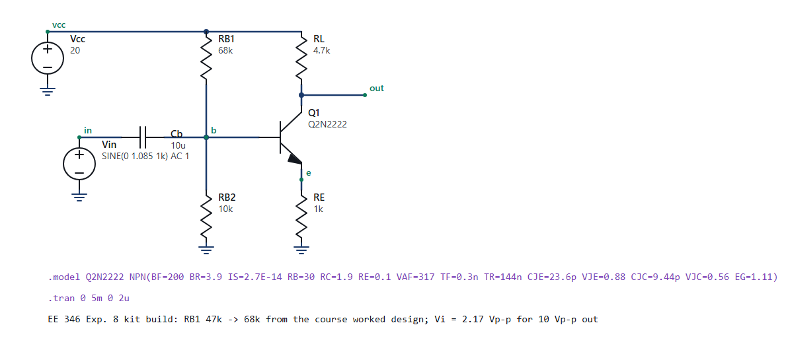
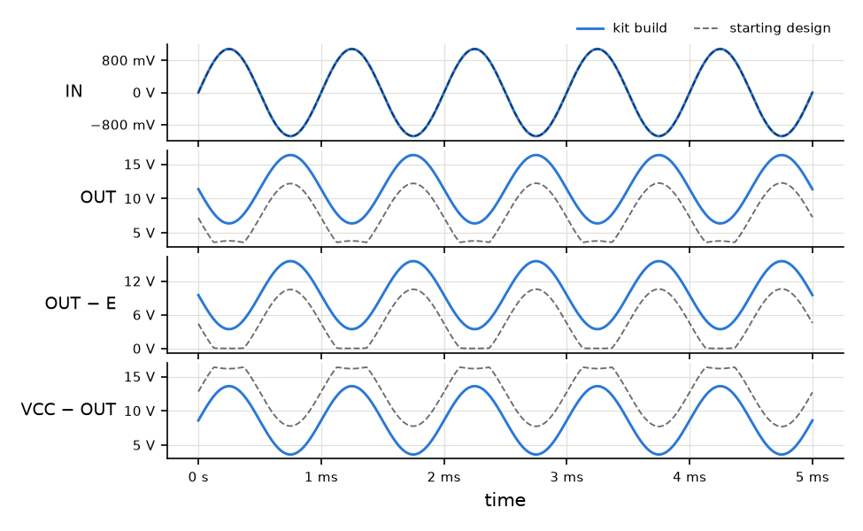
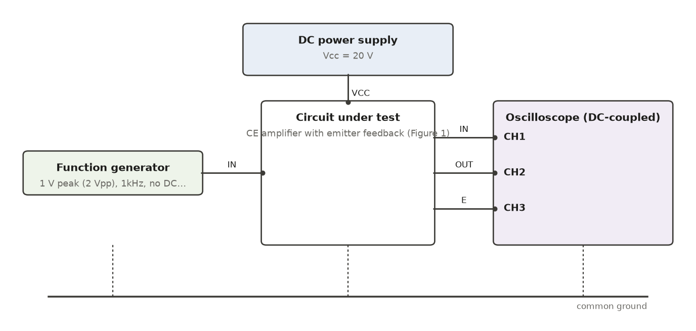

# spice-assistant

[](https://github.com/tankenbrandt/spice-assistant/actions/workflows/tests.yml)

**The problem.** A circuit that simulates isn't a circuit that works. In
September, Claude Sonnet 5 wrote eight circuits for me: all eight ran, and
only five or six met spec. Today's models (Sonnet 5.5, Opus 5.5) met spec 31
of 32 times. But even their *passing* amplifiers hold spec in only 63–91% of
simulated real builds once part tolerances come in. "It simulated" isn't
proof, "it met spec once" isn't either, and both are as true of my own lab
designs as of the AI's.

**What I wanted:** use AI to design and simulate circuits, check that they'll
work with real parts, fix whatever misses spec, confirm the answer in a
second simulator, and pick the parts from my actual lab kit. Then hand me the
pre-lab.

## What it does

1. **Writes the circuit.** Describe it in plain English and Claude writes an
   ngspice netlist, repairing it until it simulates.
2. **Checks it does what you asked.** A spec file says what "working" means
   (a gain, a swing, a truth table), and at which extremes: temperature,
   transistor β. Misses go back to the AI with the measured numbers.
3. **Tests it like a real build.** Monte Carlo over part tolerances, β and
   supply: what share of real builds would still pass.
4. **Gets a second opinion.** Everything is re-measured in LTspice, which
   shares no code with ngspice, and it writes the `.asc` schematic.
5. **Designs from your kit.** It searches the parts you actually own
   (quantities and power ratings included) for the build with the most
   margin.
6. **Writes the pre-lab.** It produces the Simulation, Design, Layout and
   Test Plan sections as a Word file: plots, schematic, pin assignments,
   test-set block diagram, expected bench readings and a blank *Measured*
   column.

Only step 1 calls the AI. Hand it a netlist and everything else is free and
runs locally.

## In my lab: designing a CE amplifier (EE 346, Experiment 8)

### What the lab asks

Choose R<sub>B1</sub>, R<sub>B2</sub>, R<sub>E</sub> and V<sub>CC</sub> for a
common-emitter amplifier (R<sub>L</sub> = 4.7 kΩ given) so that:

- the output swings **10 Vp-p with no distortion** (no clipping near
  saturation or cutoff),
- from **25 °C at β<sub>min</sub> to 100 °C at β<sub>max</sub>** (75 and
  325, the 2N2222 datasheet's range near this circuit's bias current),
- with a **gain of at least 2**, **V<sub>CC</sub> ≤ 20 V**, standard resistor
  values, and power ratings for each resistor.

That becomes a [spec file](labs/ee346_exp8/ce_amp.yaml) of checks at two
corners. The input is set from each design's measured gain, so every design
is tested at exactly 10 Vp-p out.

### The hand design, simulated

The starting point is the course's worked example: V<sub>CC</sub> = 20 V,
47k/10k divider, R<sub>E</sub> = 1k, which gives a gain of about 4.7. As a
netlist:

```spice
Vcc vcc 0 DC 20
Vin in 0 DC 0 AC 1 SIN(0 1 1k)
Cb  in b 10u
RB1 vcc b 47k
RB2 b 0 10k
RL  vcc out 4.7k
RE  e 0 1k
Q1  out b e Q2N2222      ; handout's 2N2222 parameters
```

**It saturates at both extremes.** The hand analysis checked the 5 V output
peak against V<sub>C</sub> = 6.8 V but left out the 2.7 V across
R<sub>E</sub>, so the bottom of the swing runs out of V<sub>CE</sub>:

| | 25 °C, β = 75 | 100 °C, β = 325 |
|---|---|---|
| Output (need 10 Vp-p) | 9.43 Vp-p ✗ | 7.95 Vp-p ✗ |
| Lowest V<sub>CE</sub> in the swing (need ≥ 1 V) | 0.06 V ✗ | 0.04 V ✗ |

### Designing from the kit

The tool tried every combination of resistors from my lab kit (the course's
3306L parts list, with its quantities: one 47k, two 10k, one 4.7k already
taken by R<sub>L</sub>) within 4× of the hand values. That's **96 buildable
combinations, and only 7 pass at both extremes.** The pick moves one
resistor, **R<sub>B1</sub> 47k → 68k**, and nothing else:

<p align="center">
  
</p>

<p align="center">
  
</p>

Dashed is the hand design; its V<sub>CE</sub> (OUT − E) sits flat at 0 V for
part of every cycle. The kit build (solid) never comes close:

| Kit build, R<sub>B1</sub> = 68k | 25 °C, β = 75 | 100 °C, β = 325 |
|---|---|---|
| Output | 9.98 Vp-p ✓ | 9.98 Vp-p ✓ |
| Gain | 4.56 ✓ | 4.60 ✓ |
| Lowest V<sub>CE</sub> | 4.19 V ✓ | 2.56 V ✓ |
| Q-point (V<sub>CE</sub>, I<sub>C</sub>) | 10.3 V, 1.70 mA | 8.64 V, 1.99 mA |
| Monte Carlo, ±10% resistors | 100% pass | 100% pass |

- **LTspice agrees** to within 0.002% on every check. The `.asc` above
  netlists to the same circuit in LTspice itself.
- **Power ratings:** the worst resistor (R<sub>L</sub>) dissipates 18.7 mW,
  so a 1/8 W part covers it with 2× margin. Every kit part is 1/4 W.
- **Layout:** the 2N2222 is pin 1 emitter, 2 base, 3 collector in both the
  plastic and the metal-can package (checked against both datasheets), and
  the wiring list says which way round the 10 µF electrolytic goes: + lead
  on the base, which sits at 2.5 V.

### The test plan

The report also writes the test plan: equipment, the test-set block diagram
(the course's step 6), a bench step per reading with the exact drive level
(2.17 Vp-p), DC checkpoints, and a results table with the range 90% of real
builds land in.

<p align="center">
  
</p>

```bash
python labreport.py --lab labs/ee346_exp8/lab.yaml --out runs/ee346_exp8   # about 20 s
```

### Where it fits in the course's ten-step method

| Step | What the tool does |
|---|---|
| 1. Specify | The spec file is the specification: requirements, limits and the extremes they hold at. |
| 2. Design (hand calculations) | **Not automated, on purpose.** The hand design is the starting point, and the report shows where it holds and where it doesn't. |
| 3. Simulate | ngspice and LTspice, every requirement at every extreme, waveforms, and the `.asc` file to hand in. |
| 4. Layout | Generated: every package pin, unused pins included, and a wiring list by node. CMOS assignments are re-simulated as wired. |
| 5. Test plan | Generated: equipment, procedure, expected readings and ranges. |
| 6. Test-set block diagram | Generated from the circuit's sources and the probed nodes. |
| 7–9. Build, test, parasitics | At the bench. |
| 10. Discuss (double weight) | Every expected reading comes with the range real builds land in, so a bench result outside it means something is wrong. |

## A digital lab too: CMOS gates (EE 347, Experiment 4)

Five circuits from CD4007 transistors and 4001B gates, with truth tables as
specs. **All 37 rows simulate as expected and LTspice agrees on all five.**
Two of the handout's questions come back as numbers: the NMOS pass-gate mux
only pulls X to **5.19 V** from an 8 V supply (threshold plus body effect),
while the transmission-gate version reaches the full **8.0 V**.

**Layout is a real problem here.** A CD4007 holds six transistors that share
gate pins, a drain and the supply pins. So the tool *assigns* each circuit's
transistors to package slots: one chip for most figures, two for Fig. 4.5's
five NMOS. It then re-simulates the circuit rebuilt pin by pin, idle
transistors included. That check caught an idle P-channel left floating on
Fig. 4.4's precharged node: with breadboard-grade leakage on its free pin, the
node sagged to 2.15 V. The pin table now ties that pin back to the node.

Pre-lab 2's timing diagram comes out the way the handout draws it:

<p align="center">
  
</p>

## How good is the AI at this?

8 circuits × 4 runs per model, every result measured against its spec, then
500 simulated builds of each CE amplifier:

| Model | Simulate | Meet spec | CE amp real-build yield, passing designs |
|---|---|---|---|
| Sonnet 5 (Sept 2026) | 8/8 | 5–6 | none passed (1% yield; 69% after the tool's repair) |
| Sonnet 5.5 (Nov 2026) | 8/8 | 7–8 | 63–85% |
| Opus 5.5 (Nov 2026) | 8/8 | 7–8 | 85–91% |

Newer models fixed nominal correctness; tolerance is now where designs fail.
All four runs per model cost $0.33–0.59. The September worst case, a CE
amplifier that ran perfectly with a gain of **107 instead of 50** (its bypass
capacitor shorted the whole emitter resistor), is written up with the repair
in [docs/how-it-works.md](docs/how-it-works.md#how-good-is-the-ai-at-this-really).

<p align="center">
  
</p>

## Quick start

```bash
pip install -e ".[labreport]"   # Python 3.10+, plus ngspice (setup in docs/how-it-works.md)
python labreport.py --lab labs/ee346_exp8/lab.yaml --out runs/ee346_exp8   # a whole pre-lab
python kit.py examples/ce_bjt_amp_recentred.cir --spec specs_lib/ce_bjt_amp.yaml
python main.py "an RC low-pass filter with a 1 kHz cutoff"   # needs ANTHROPIC_API_KEY
```

Install details, every module and how each claim above was verified:
**[docs/how-it-works.md](docs/how-it-works.md)**. 684 tests, no API calls,
CI on Linux and Windows.
